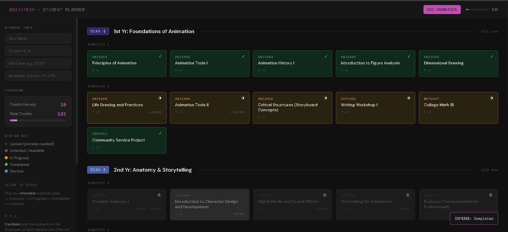
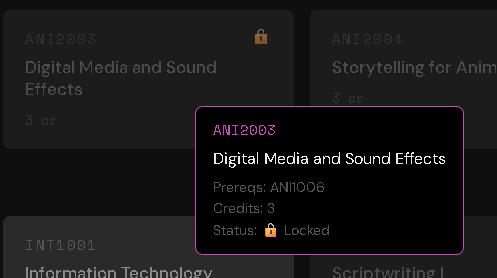
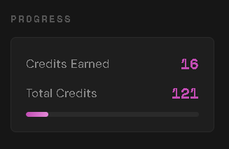
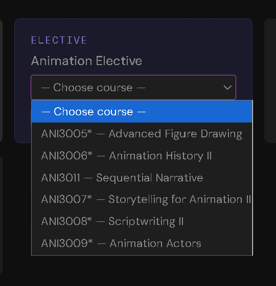
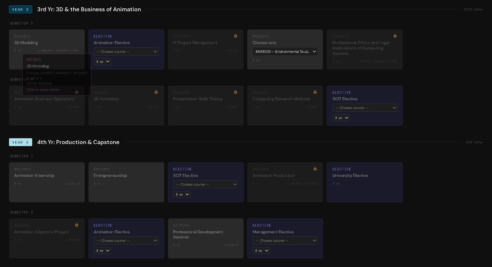

# utech-ani-planner

> An interactive degree-progress tracker for UTech Jamaica **BSc Animation Development and Production** students.



---

## What It Does

Click any unlocked course to cycle its status: **Available → In Progress → Completed**.  
Prerequisite courses unlock automatically as you complete their dependencies.  
Pick your exact electives, set their credit values, and watch credits and overall percentage update in real time.

**No account. No server. Nothing leaves your browser.**

---

## Features

| Feature | Detail |
|---|---|
| 🎓 Single programme | BSc Animation Development and Production — 4 years, 8 semesters |
| 🔒 Prereq locking | Courses unlock only when dependencies are met (including "either/or" prereqs) |
| 🎨 Elective picker | Choose the exact SCIT, Management or Animation elective from the official list |
| 🎚 Elective credits | Set 3 or 4 credits for each listed elective |
| 🚫 No double-picks | A course chosen in one elective slot is greyed out in the other slots |
| 🔀 Either/or slot | Pick ENS3001, HEA3004 or SCT2001 in Semester 5 — credits follow your choice |
| 📊 Live credit counter | Tracks earned vs. total credits (121–126 depending on choices) |
| 💾 Offline-first | All data in `localStorage` — works without internet |
| 📤 Export / Import | JSON backup (including elective picks) so you can move data between devices |
| 🔐 XSS-safe | All output escaped; no user data ever hits a server |

---

## Screenshots

> _Placeholders — drop the images into `screenshots/` with these names._

| View | Description |
|---|---|
|  | Years 1 and 2 of the full 4-year plan |
|  | Locked courses with tooltip showing missing prereqs |
|  | Sidebar credits counter updating after completions |
|  | Choosing an elective course and its credit value |
|  | Years 3 and 4 — 3D, production and capstone |

---

## How to Use

1. **Open** `index.html` in any browser — no install needed.
2. **Click a course** to mark it In Progress, then Completed.
3. **Pick your electives** from the dropdown on each elective card, then set 3 or 4 credits.
4. **Export** your progress via the sidebar to back it up or move to another device.

---

## Local Development

```bash
git clone https://github.com/YOUR_USERNAME/utech-ani-planner.git
cd utech-ani-planner
# Open index.html in your browser — that's it.
```

No build step. No dependencies. Pure HTML/CSS/JS.

---

## Project Structure

```
utech-ani-planner/
├── index.html          # Entire app — single file
├── screenshots/        # README screenshots
│   ├── full-view.png
│   ├── prereq-lock.png
│   ├── credits-sidebar.png
│   ├── elective-picker.png
│   └── years-3-4.png
└── README.md
```

---

## Curriculum Data

Course data is sourced from the official **UTech Jamaica SCIT Module Selection Guide — BSc Animation Development and Production** (starting AY 2023/24).

| Year | Semesters | Credits |
|---|---|---|
| 1 — Foundations of Animation | 1, 2 | 32 |
| 2 — Anatomy & Storytelling | 3, 4 | 32 |
| 3 — 3D & the Business of Animation | 5, 6 | 31–34 |
| 4 — Production & Capstone | 7, 8 | 25–28 |
| **Total** | | **121–126** (120 if SCT2001 is chosen with all 3-credit electives) |

### Electives

| Slot | Semester | List |
|---|---|---|
| Animation Elective | 5, 8 | ANI3005\*, ANI3006\*, ANI3011, ANI3007\*, ANI3008\*, ANI3009\* |
| SCIT Elective | 6, 7 | CMP1026, CIT2011\*, CIT3025\*, CIT3021\*, CIT3020\*, CIT3028\*, CIT4032\*, CIT3023\* |
| Management Elective | 8 | MKT2001\*, LAW2001\*, MKT3010\*, MAN3001, ACC1001, MKT4015\* |
| University Elective | 7 | Any university course (3 credits) |

\* Has prerequisite(s) of its own — confirm with your academic advisor.

### Notes on how the guide is modelled
- **ANI3012 3D Modeling** lists "ANI1007, ANI1009 or ANI3003". Only ANI1009 is in this programme, so it is the course that unlocks 3D Modeling.
- **HUM3010** lists "CAT1001, COM1020 or COM1024". Only CAT1001 is in this programme, so it is the course that unlocks HUM3010.
- **ANI3010 Animation Internship** (Level 3) and **CIT4036 Professional Development Seminar** (Level 4) need a level standing; this is shown on the card but does not lock the course.
- **University Elective** is a free choice with a fixed 3 credits, matching the guide's 121–126 credit range.
- Year labels ("Foundations of Animation", etc.) are the planner's own; the guide only numbers the semesters.

---

## Security Notes

- All HTML output is escaped with a custom `esc()` function; tooltips are built with `textContent`.
- No inline event handlers are built from data — clicks are handled by delegated listeners.
- `localStorage` reads are validated — only known course IDs, statuses and elective codes are accepted.
- No external API calls. CSP meta tag blocks external script injection.
- Student info has `<` and `>` stripped and is capped at 200 characters before storage.
- Storage keys are prefixed `ani_` so this planner never clashes with other UTech planners on the same site.

---

## Contributing

Found a course discrepancy? Open an issue or pull request.  
Contributions welcome — especially if UTech updates the programme structure.

---

## License

MIT — free to use, share, and modify.

---

*Built for UTech Jamaica Animation students. Not an official UTech product.*
